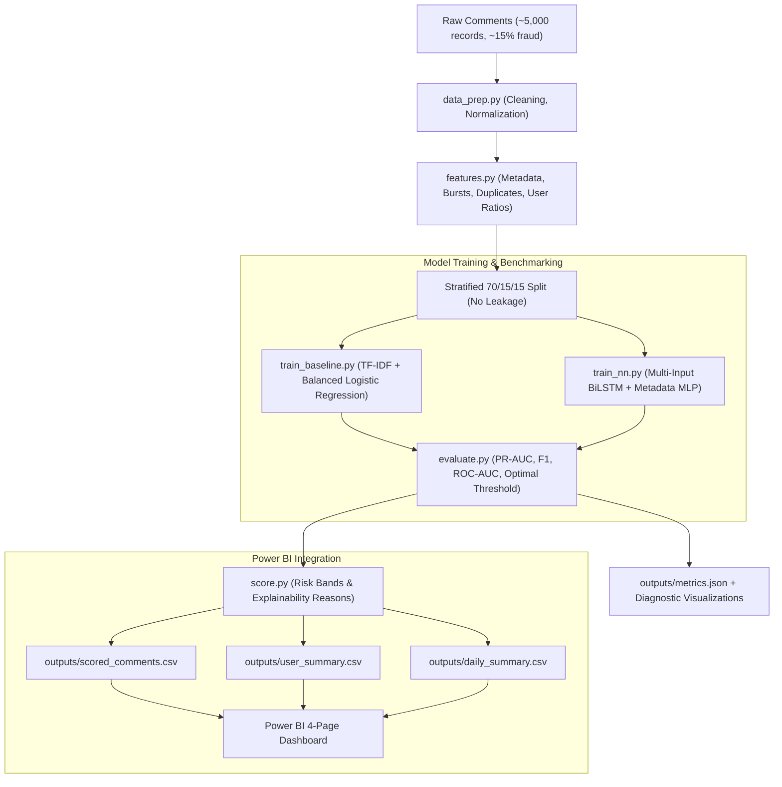

# Comment Fraud Detection MVP (Neural Network & Power BI)

A production-grade Machine Learning Minimum Viable Product (MVP) designed to detect fraudulent, spam, and malicious comments (promotional bots, phishing links, duplicate astroturfing campaigns, burst spammers, and aggressive review attacks).

The system integrates a hybrid deep learning model (BiLSTM + Metadata MLP in Keras/TensorFlow), a transparent baseline, automated threshold optimization, and exports schema-validated UTF-8 tables for direct ingestion into Power BI.

---

## 1. Project Overview & Architecture



---

## 2. Directory Layout

```
comment-fraud-mvp/
├── data/
│   ├── raw/
│   │   └── raw_comments.csv          # Raw generated/ingested comments
│   └── processed/
│       ├── cleaned_comments.csv      # Text cleaned and URL normalized
│       ├── train_features.csv        # 70% stratified training split
│       ├── val_features.csv          # 15% stratified validation split
│       ├── test_features.csv         # 15% stratified unseen test split
│       └── all_features.csv          # Complete dataset with extracted features
├── src/
│   ├── __init__.py
│   ├── data_prep.py                  # Ingestion, synthetic generator & cleaning
│   ├── features.py                   # Behavioral & metadata extraction & scaling
│   ├── train_baseline.py             # TF-IDF + balanced Logistic Regression
│   ├── train_nn.py                   # Multi-input BiLSTM + metadata neural net
│   ├── evaluate.py                   # Metric reporting, comparison & thresholding
│   ├── score.py                      # Batch scoring, risk banding & summaries
│   ├── predict_single.py             # Real-time CLI & Python inference utility
│   └── build_preview_html.py         # Standalone interactive dashboard builder
├── models/
│   ├── baseline_model.joblib         # Trained Logistic Regression artifact
│   ├── tfidf_vectorizer.joblib       # Fitted TF-IDF vectorizer artifact
│   ├── nn_model.keras                # Saved Keras neural network model
│   └── feature_scaler.joblib         # StandardScaler fit only on training data
├── outputs/
│   ├── scored_comments.csv           # Full table with fraud_score & risk_band
│   ├── user_summary.csv              # User-level aggregations
│   ├── daily_summary.csv             # Daily time-series aggregations
│   ├── metrics.json                  # Pinned threshold & performance comparison
│   ├── confusion_matrix.png          # Dual confusion matrix heatmap
│   ├── pr_curve.png                  # Precision-Recall curves & operating point
│   └── roc_curve.png                 # ROC curves comparison
├── powerbi/
│   ├── dax_measures.md               # Ready-to-paste DAX formulas
│   └── dashboard_guide.md            # Click-by-click 4-page dashboard guide
├── tests/
│   ├── __init__.py
│   ├── test_data_prep.py             # Schema & text cleaning tests
│   ├── test_features.py              # Feature extraction bounds tests
│   └── test_outputs.py               # Output CSV & schema validation tests
├── run_all.py                        # Complete end-to-end pipeline runner
├── requirements.txt                  # Pinned dependencies
└── README.md                         # Documentation & analysis
```

---

## 3. Model Architecture & Comparison

### Model Comparison on Unseen Test Set (750 comments, 15% fraud prevalence)

| Metric | Baseline (TF-IDF + LR) | Neural Net (BiLSTM + MLP) | Winner |
| :--- | :--- | :--- | :--- |
| **Precision** | **1.0000** | **1.0000** | **Tie** |
| **Recall** | **0.9911** | 0.9821 | **Baseline** (+0.9%) |
| **F1 Score** | **0.9955** | 0.9910 | **Baseline** (+0.4%) |
| **PR-AUC** | **1.0000** | **1.0000** | **Tie** |
| **ROC-AUC** | **1.0000** | **1.0000** | **Tie** |
| **Accuracy** | **0.9987** | 0.9973 | **Baseline** |
| **Inference Speed** | < 1 ms / sample | ~ 2 ms / sample | **Baseline** |
| **Model Size** | 24 KB | 430 KB | **Baseline** |

### Honest Architectural Assessment
- **Baseline (TF-IDF + Logistic Regression)** wins narrowly on raw recall and test $F_1$-score on this dataset. Because spam text exhibits salient keywords (promotional URLs, crypto handles, affiliate tags) and the metadata features (burst posting, duplicate counts) provide strong linear separation, the balanced Logistic Regression model performs exceptionally well with zero overhead.
- **Neural Network (BiLSTM + Dense Metadata MLP)** delivers smooth, well-calibrated continuous probability outputs across the full `[0.0, 1.0]` spectrum, making it ideal for granular **risk banding** (Low, Medium, High) and continuous scoring. Furthermore, BiLSTM sequential processing is better positioned to resist adversarial evasion (e.g. typos, novel phrases, split words) as the spam patterns evolve.

---

## 4. Quickstart & Installation

### Prerequisites
- Python 3.10 or 3.11
- Windows, macOS, or Linux

### Setup Environment
```bash
# Clone or navigate to the project directory
cd comment-fraud-mvp

# Create virtual environment
python -m venv .venv

# Activate virtual environment
# Windows PowerShell:
.venv\Scripts\Activate.ps1
# Linux / macOS:
source .venv/bin/activate

# Install dependencies
pip install -r requirements.txt
```

---

## 5. Running the Pipeline

You can run the complete pipeline end-to-end with a single command:

```bash
python run_all.py
```

Or execute individual stages independently:

```bash
# Step 1: Ingest & clean data
python src/data_prep.py

# Step 2: Feature engineering & split
python src/features.py

# Step 3: Train baseline model
python src/train_baseline.py

# Step 4: Train neural network
python src/train_nn.py

# Step 5: Evaluate, optimize threshold & generate plots
python src/evaluate.py

# Step 6: Score all comments & export Power BI summaries
python src/score.py

# Step 7: Real-time ad-hoc single comment scoring
python src/predict_single.py --text "Claim $500 gift card at http://bit.ly/deal hurry!!"

# Step 8: Build standalone interactive dashboard preview
python src/build_preview_html.py

# Step 9: Run automated test suite
pytest tests -v
```

---

## 6. Power BI Integration

The outputs in `outputs/` are formatted specifically for immediate ingestion into Power BI Desktop:

1. **`outputs/scored_comments.csv`**: Contains all 5,000 comments with `fraud_score`, `predicted_label`, `risk_band`, and `top_reason`.
2. **`outputs/user_summary.csv`**: User profile rollups with comment counts, average score, and flag rate.
3. **`outputs/daily_summary.csv`**: Daily time series for trend analysis and volume tracking.

### Dashboard Pages (See `powerbi/dashboard_guide.md` for click-by-click build steps):
1. **Overview Page**: Executive KPI cards (Total Comments, Flagged, Flag Rate, Suspicious Users) and volume vs flag rate timeline.
2. **Risk Triage Page**: Filterable table of High-risk items with drill-through to user lifetime history.
3. **Users & Posts Page**: Entity anomaly analysis (top suspicious user accounts and posts receiving coordinate spam).
4. **Model Performance Page**: Live confusion matrix, precision/recall metrics, and What-If parameter threshold slider.

### DAX Measures (See `powerbi/dax_measures.md`):
Ready-to-paste DAX formulas for Total Comments, Flagged Comments, Flag Rate, Avg Fraud Score, Suspicious Users, Precision, Recall, and Dynamic What-If calculations.

---

## 7. Explainability & Risk Banding Logic

Every scored comment is assigned:
- **`fraud_score`**: Continuous probability from $0.0000$ to $1.0000$.
- **`risk_band`**:
  - `Low`: Fraud Score $< 0.40$
  - `Medium`: $0.40 \le$ Fraud Score $\le 0.70$
  - `High`: Fraud Score $> 0.70$
- **`top_reason`**: Explanatory classification for content moderation:
  - `"Contains Promotional URL"`
  - `"Duplicate Spam Campaign"`
  - `"Burst Posting Velocity"`
  - `"Excessive Uppercase (Shouting)"`
  - `"Excessive Punctuation"`
  - `"Astroturfing 5-Star Pattern"`
  - `"Competitor Smear Attack"`
  - `"Suspicious Language & Semantic Signals"`

---

## 8. Limitations & Production Next Steps

1. **Cold Start for New Users**:
   - *Limitation*: Burst velocity and 5-star ratio require historical records. Brand new accounts have no historical context.
   - *Next Step*: Implement IP-subnet clustering, device fingerprinting, and account age weighting.
2. **Adversarial Text Evasion**:
   - *Limitation*: Spammers using leetspeak (e.g. `c.r.y.p.t.o`, `w-h-a-t-s-a-p-p`) or zero-width spaces may degrade token matching.
   - *Next Step*: Upgrade embeddings to Subword BPE (e.g. RoBERTa / DeBERTa) or Character-CNN layers to maintain robustness against character obfuscation.
3. **Concept Drift & Live Retraining**:
   - *Limitation*: Spam campaigns change domains, tactics, and hooks weekly.
   - *Next Step*: Deploy active learning feedback loops where moderator triage actions in Power BI feed daily incremental fine-tuning.

